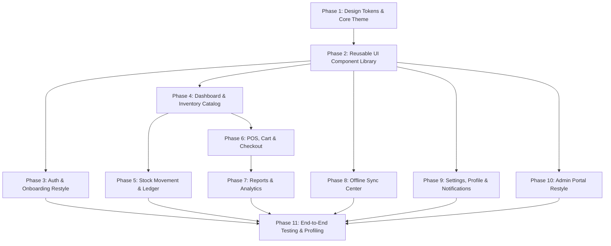

# Kera Spare Tracker — Stitch UI/UX Integration & Implementation Plan

**Document Version:** 1.0.0  
**Target:** Phased, safe migration of the existing Flutter app (`c:\Users\Ashu\Kera-Spare-Tracker-App`) to match the Google Stitch Design System (`projects/18265425042522896944`).

---

## 1. Guiding Rules & Safety Principles

1. **Strictly Non-Destructive**: Do not rebuild the application or create a second codebase. Refactor the existing Flutter client in-place.
2. **Preserve Database & Offline Capabilities**: The Drift SQLite database schemas, DAOs, append-only ledger for stock movements, and outbox sync queue must remain untouched.
3. **Preserve Backend & Auth Contracts**: No breaking changes to the Express/Prisma API endpoints, JWT token rotation rules, bcrypt password verification, or admin mutual boundaries.
4. **Zero Mock Data**: Never swap existing real repository bindings with mock data. Real local SQLite data must power every screen.
5. **Phase-Gated Quality**: After each phase, run `flutter analyze` and `flutter test` to ensure zero regressions across the 34 existing test suites.

---

## 2. Phased Implementation Roadmap

---

### Phase 1: Core Design System & Tokens
**Goal:** Establish a single source of truth for color tokens, typography scales, spacing, border radii, and theme definitions.

- [ ] **Step 1.1**: Create `lib/core/design/tokens/kera_colors.dart` matching Stitch:
  - Primary Navy: `#172B4D`
  - Action Blue: `#2563EB`
  - Utility Teal: `#0D9488`
  - Canvas: `#F8FAFC`, Pure Surface: `#FFFFFF`
  - Semantic Status: In-Stock (`#DCFCE7`/`#16A34A`), Low Stock (`#FEF3C7`/`#D97706`), Out of Stock (`#FEE2E2`/`#DC2626`), Offline (`#FEF3C7`/`#B45309`).
- [ ] **Step 1.2**: Create `lib/core/design/tokens/kera_typography.dart`:
  - Configure dual-script font styling pairing `NotoSansEthiopic` and `Inter`.
  - Implement full type scale (`headlineLarge`, `headlineMedium`, `headlineSmall`, `titleMedium`, `bodyLarge`, `bodyMedium`, `bodySmall`, `labelLarge`, `labelMedium`, `labelSmall`, `numericStat`).
  - Enable `FontFeature.tabularFigures()` on all monetary displays.
- [ ] **Step 1.3**: Create `lib/core/design/tokens/kera_spacing.dart` and `kera_radii.dart`:
  - 4px, 8px, 12px, 16px, 24px, 32px spacing standards.
  - 6px (tags), 10px (cards/fields/buttons), 16px (bottom sheets), 9999px (pills).
- [ ] **Step 1.4**: Update [app_theme.dart](file:///c:/Users/Ashu/Kera-Spare-Tracker-App/lib/core/theme/app_theme.dart) to expose `KeraTheme.lightTheme` with Material 3 integration.

---

### Phase 2: Foundational Reusable UI Components
**Goal:** Build the industrial component kit specified in Stitch screen `b02c232101c64182a77ebd03c3cd6e61`.

- [ ] **Step 2.1**: `KeraButton` (`lib/core/design/widgets/kera_button.dart`):
  - Primary Blue, Secondary Navy, Outlined Neutral, and Destructive Red variants.
  - Guaranteed $\ge 48\text{ px}$ height and touch targets.
  - Built-in loading state spinner.
- [ ] **Step 2.2**: `KeraTextField` (`lib/core/design/widgets/kera_text_field.dart`):
  - Stacked label pattern, 10px radius, 1px `#E2E8F0` border, 2px focus ring.
  - Prefix/suffix icon triggers (Barcode scan, clear, password visibility toggle).
- [ ] **Step 2.3**: `KeraProductCard` (`lib/core/design/widgets/kera_product_card.dart`):
  - 64x64px thumbnail with asynchronous disk resolution (fixing the `File.existsSync()` UI bottleneck).
  - OEM badge pill, shelf location tag, stock status badge, tabular price in Birr.
- [ ] **Step 2.4**: `KeraStatusBadge` (`lib/core/design/widgets/kera_status_badge.dart`):
  - Compact badges for `In-Stock`, `Low Stock`, `Out of Stock`, `Synced`, and `Offline Queue`.
- [ ] **Step 2.5**: `KeraAppBar` & `KeraSyncPill` (`lib/core/design/widgets/kera_app_bar.dart`):
  - Solid `#172B4D` background with live sync indicator pill.
- [ ] **Step 2.6**: `KeraBottomSheet`, `KeraEmptyState`, `KeraSkeletonLoader`, and `KeraConfirmDialog`.

---

### Phase 3: Auth, Splash & Onboarding Restyling
**Goal:** Modernize the initial user entry journey without touching authentication credentials or token rotation.

- [ ] **Step 3.1**: Restyle [splash_screen.dart](file:///c:/Users/Ashu/Kera-Spare-Tracker-App/lib/features/splash/presentation/splash_screen.dart) (Stitch Screen `4ee69d9cd07b4890a338fd75a5d1ad37`).
- [ ] **Step 3.2**: Implement `WelcomeScreen` (Stitch Screen `3ad7b1f3c1e34365ab1372a194619ca1`).
- [ ] **Step 3.3**: Restyle [login_screen.dart](file:///c:/Users/Ashu/Kera-Spare-Tracker-App/lib/features/auth/presentation/screens/login_screen.dart) with stacked fields and server selector (Stitch Screen `ee59c0a8a4f2425db0fa28dc3d5e1dcd`).
- [ ] **Step 3.4**: Restyle [register_screen.dart](file:///c:/Users/Ashu/Kera-Spare-Tracker-App/lib/features/auth/presentation/screens/register_screen.dart) with step-by-step layout (Stitch Screen `8c31ab3d421340369d58e66b85f78066`).
- [ ] **Step 3.5**: Restyle [change_password_screen.dart](file:///c:/Users/Ashu/Kera-Spare-Tracker-App/lib/features/auth/presentation/screens/change_password_screen.dart) and add forgot password guide (Stitch Screen `2923eb9eddb74a8b813a60ac1739da4a`).
- [ ] **Step 3.6**: Restyle [initial_sync_screen.dart](file:///c:/Users/Ashu/Kera-Spare-Tracker-App/lib/features/sync/presentation/screens/initial_sync_screen.dart) with first-time onboarding step indicator (Stitch Screen `32a38ff128c242509e26d9a8e57df57b`).

---

### Phase 4: Business Dashboard & Inventory Catalog
**Goal:** Deliver the high-density shop owner dashboard and optimize catalog browsing.

- [ ] **Step 4.1**: Create `BusinessDashboardScreen` (Stitch Screen `3b5476bfcf2240d986025bc9331e2b1e`) featuring:
  - Header greeting and sync pill.
  - Quick action grid (`+ Part`, `New Sale`, `Restock`, `Scanner`).
  - Today's sales & profit card.
  - Mini 7-day sales trend sparkline.
  - Top 3 fast-moving parts.
- [ ] **Step 4.2**: Update [home_screen.dart](file:///c:/Users/Ashu/Kera-Spare-Tracker-App/lib/features/home/presentation/screens/home_screen.dart) bottom navigation bar to include `Dashboard`, `Inventory`, `Sales`, `Reports`, and `Settings`.
- [ ] **Step 4.3**: Restyle [inventory_screen.dart](file:///c:/Users/Ashu/Kera-Spare-Tracker-App/lib/features/parts/presentation/screens/inventory_screen.dart) with `KeraProductCard`, search bar with barcode scan trigger, and quick filter chips (Stitch Screen `ed8c8a3436004f59b621fe4eca731dec`).
- [ ] **Step 4.4**: Optimize [inventory_screen.dart](file:///c:/Users/Ashu/Kera-Spare-Tracker-App/lib/features/parts/presentation/screens/inventory_screen.dart) search listening via `ref.watch(...select(...))` to eliminate rebuild lag.
- [ ] **Step 4.5**: Restyle [part_form_screen.dart](file:///c:/Users/Ashu/Kera-Spare-Tracker-App/lib/features/parts/presentation/screens/part_form_screen.dart) (Add/Edit) with camera/gallery tiles and unit chips (Stitch Screens `b6cdff773d164c589556d6f71a88e80a` & `9c59f6a34eb94b1aa34f0613075b8378`).
- [ ] **Step 4.6**: Restyle [part_details_screen.dart](file:///c:/Users/Ashu/Kera-Spare-Tracker-App/lib/features/parts/presentation/screens/part_details_screen.dart) with hero photo header and profit margin pill (Stitch Screen `02d6d59f768441968f7dc9e0ad1727e3`).
- [ ] **Step 4.7**: Restyle [inventory_filter_sheet.dart](file:///c:/Users/Ashu/Kera-Spare-Tracker-App/lib/features/parts/presentation/widgets/inventory_filter_sheet.dart) (Stitch Screen `2398b180d56e4376a2e8cc8a6927923a`).

---

### Phase 5: Stock Movement & Ledger Restyling
**Goal:** Expose append-only stock movement history and ledger health.

- [ ] **Step 5.1**: Restyle [low_stock_screen.dart](file:///c:/Users/Ashu/Kera-Spare-Tracker-App/lib/features/stock/presentation/screens/low_stock_screen.dart) into `StockOverviewScreen` (Stitch Screen `ab87d128300a49bc93cd3b237d655344`).
- [ ] **Step 5.2**: Convert [update_stock_dialog.dart](file:///c:/Users/Ashu/Kera-Spare-Tracker-App/lib/features/stock/presentation/dialogs/update_stock_dialog.dart) into a responsive bottom sheet with `+ / -` steppers and quick `+10`, `+50` pills (Stitch Screens `230bbdd6d8bf48ac96f3c0d303cdbc07` & `d889174b4f17480489c4907273d38f61`).
- [ ] **Step 5.3**: Restyle [stock_history_screen.dart](file:///c:/Users/Ashu/Kera-Spare-Tracker-App/lib/features/stock/presentation/screens/stock_history_screen.dart) into a chronological ledger timeline with running balance indicators (Stitch Screens `db93a845c7be4dcca08f7d72c4594a42` & `42561ac66ab4440d8cd69099c50e55a8`).

---

### Phase 6: Point of Sale (POS), Shopping Cart & Checkout
**Goal:** Accelerate counter sales with instant cart additions and offline digital receipts.

- [ ] **Step 6.1**: Restyle [new_sale_screen.dart](file:///c:/Users/Ashu/Kera-Spare-Tracker-App/lib/features/sales/presentation/screens/new_sale_screen.dart) with category tabs and floating cart bar (Stitch Screen `144874045aab4f2a9c1344f0fe2f60e2`).
- [ ] **Step 6.2**: Restyle Shopping Cart bottom sheet / view with steppers and unit price overrides (Stitch Screen `23cfac7b0af74b219f4b34d9e3179369`).
- [ ] **Step 6.3**: Implement Checkout drawer with payment method selector (Cash, Telebirr, CBE Birr, Credit) and customer details (Stitch Screen `15a2d18af33646dea9c9081d74618865`).
- [ ] **Step 6.4**: Restyle [sale_success_screen.dart](file:///c:/Users/Ashu/Kera-Spare-Tracker-App/lib/features/sales/presentation/screens/sale_success_screen.dart) into thermal digital receipt with WhatsApp sharing (Stitch Screen `8e5e7f4361494b67a0f0d4569a0e86d9`).
- [ ] **Step 6.5**: Restyle [sales_list_tab.dart](file:///c:/Users/Ashu/Kera-Spare-Tracker-App/lib/features/sales/presentation/screens/sales_list_tab.dart) and [sale_details_screen.dart](file:///c:/Users/Ashu/Kera-Spare-Tracker-App/lib/features/sales/presentation/screens/sale_details_screen.dart) with thermal receipt preview (Stitch Screens `c7272577575e4233873761835539d939` & `ab558d73521d4c9db3998d41e09bb549`).

---

### Phase 7: Reports, Visualizations & Analytics
**Goal:** Deliver clarity on shop profitability and fast/slow-moving stock.

- [ ] **Step 7.1**: Restyle [reports_screen.dart](file:///c:/Users/Ashu/Kera-Spare-Tracker-App/lib/features/reports/presentation/screens/reports_screen.dart) with period selector (Today, Week, Month, Year, Custom) and module tiles (Stitch Screen `5b8bf8b1426f438c81e73c605948260c`).
- [ ] **Step 7.2**: Implement Profit & Loss report section (Revenue, Cost of Goods Sold, Gross Profit) with owner-only access (Stitch Screen `dc658d961a41465faeb65d471c31fff0`).
- [ ] **Step 7.3**: Implement Inventory valuation & Category breakdown chart (Stitch Screen `1b7696b9f2c94095baf7b66c496690fe`).
- [ ] **Step 7.4**: Implement Best-Selling products ranked leaderboard (Stitch Screen `df37fc4c7e434b85a58b88e7241c2b7e`).
- [ ] **Step 7.5**: Create export reports screen with date pickers and CSV/PDF export (Stitch Screen `5b931ac290c240f786ef92cabfe07d63`).

---

### Phase 8: Offline Sync Center & Diagnostics
**Goal:** Provide shop owners with full visibility and control over their offline sync queue.

- [ ] **Step 8.1**: Create `SyncCenterScreen` (`/sync/queue`) displaying pending mutations count, entity breakdown, and manual "Sync Now" trigger (Stitch Screen `b8ca61d2422142fc9708c95af09eb0ac`).
- [ ] **Step 8.2**: Create `SyncDiagnosticsSheet` displaying last sync time, server ping latency, and error logs (Stitch Screen `0b15ccf164604a2087f13ff0ad120e35`).
- [ ] **Step 8.3**: Create `ConflictResolutionDialog` comparing local vs server values with "Keep Mine" or "Keep Server" options (Stitch Screen `3553c1239f2d46fe8f85fda7c1c0c1d9`).

---

### Phase 9: Settings, Profile & Notifications
**Goal:** Polish business profile, notifications, and security session controls.

- [ ] **Step 9.1**: Restyle [settings_screen.dart](file:///c:/Users/Ashu/Kera-Spare-Tracker-App/lib/features/settings/presentation/screens/settings_screen.dart) with grouped card sections and chevron navigation (Stitch Screen `107a86fa3fee4a7ab517bf94a4183d15`).
- [ ] **Step 9.2**: Restyle Business Profile editor (Shop name, TIN, phone, receipt notes) (Stitch Screen `55c258c7e76b4eb197baf12efd0c9235`).
- [ ] **Step 9.3**: Create `NotificationCenterScreen` (`/notifications`) for low stock warnings and system maintenance announcements (Stitch Screen `3e665eda70604b479de6875c044698ce`).
- [ ] **Step 9.4**: Create `LanguageSelectionSheet` for switching between Amharic and English (Stitch Screen `dba990b8d7ba40aea37e2a43c28a05bf`).
- [ ] **Step 9.5**: Restyle [app_lock_screen.dart](file:///c:/Users/Ashu/Kera-Spare-Tracker-App/lib/features/security/presentation/screens/app_lock_screen.dart) and security session settings (Stitch Screen `38ce157a5dcd43379834f1d00fe0fb6b`).

---

### Phase 10: Admin Portal & Multi-Business Management
**Goal:** Align the super-admin web/mobile portal with Stitch while maintaining strict zero-knowledge tenant isolation.

- [ ] **Step 10.1**: Restyle [admin_dashboard_screen.dart](file:///c:/Users/Ashu/Kera-Spare-Tracker-App/lib/features/admin/presentation/screens/admin_dashboard_screen.dart) with platform aggregate metric cards (Stitch Screen `746c0eef0d1343cabe8b17467c3a6867`).
- [ ] **Step 10.2**: Restyle [admin_owners_list_screen.dart](file:///c:/Users/Ashu/Kera-Spare-Tracker-App/lib/features/admin/presentation/screens/admin_owners_list_screen.dart) with tenant status pills and search (Stitch Screen `4c29eec9d5794930a766e8fa7a2b1b3c` & `f22de1e17aea4040ba70884471c61b13`).
- [ ] **Step 10.3**: Restyle [admin_owner_details_screen.dart](file:///c:/Users/Ashu/Kera-Spare-Tracker-App/lib/features/admin/presentation/screens/admin_owner_details_screen.dart) with suspension modal and audit trail (Stitch Screen `69f50eb7db5c4896af6b854445a67d0c`).
- [ ] **Step 10.4**: Restyle [admin_settings_screen.dart](file:///c:/Users/Ashu/Kera-Spare-Tracker-App/lib/features/admin/presentation/screens/admin_settings_screen.dart) for global brands, categories, and maintenance mode (Stitch Screen `89c632d938a6427ea6c6e32f289c77d4`).

---

### Phase 11: End-to-End Verification & Performance Profiling
**Goal:** Certify functionality, safety, and performance against all project specifications.

- [ ] **Step 11.1**: Run `flutter analyze` and resolve all warnings.
- [ ] **Step 11.2**: Run `flutter test` and confirm all 34 existing test suites pass with 100% green status.
- [ ] **Step 11.3**: Add unit tests for `KeraButton`, `KeraProductCard`, and `KeraTextField`.
- [ ] **Step 11.4**: Perform DevTools performance profiling on a 2,000-item catalog to guarantee $\le 16.6\text{ ms}$ frame rendering.
- [ ] **Step 11.5**: Validate offline continuity: Disconnect WiFi/Cellular, record 5 sales, restart app, verify sales appear in sales history and queue, reconnect internet, verify successful sync push.

---

## 3. Definition of Done

1. All 56 Stitch screens and components are represented in the Flutter application.
2. The UI matches the high-density industrial design system (`#172B4D` Navy, `#2563EB` Action Blue, `#F8FAFC` Canvas).
3. The app runs fully offline without crashes or blocking dialogs.
4. All existing tests pass without modification to business rules or backend contracts.
5. `File.existsSync()` is completely removed from list rendering build methods.

